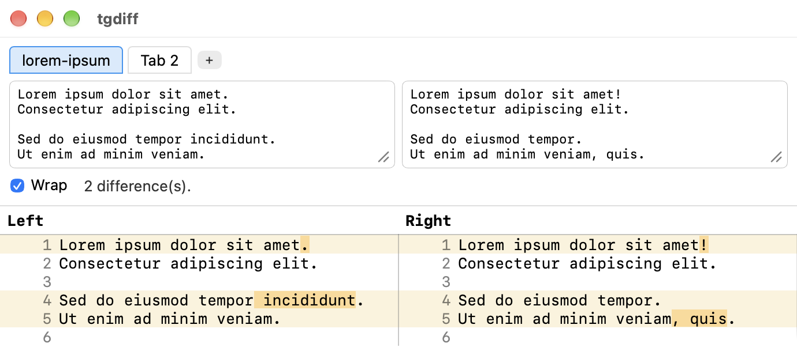

<h1 align="center">tgdiff</h1>
<p align="center">
  <br>
  Compare text with ease.
</p>

<p align="center">
  
</p>

## Usage

```sh
task              # build and open the desktop app
task test         # unit, integration and e2e tests
task count-tests
```
